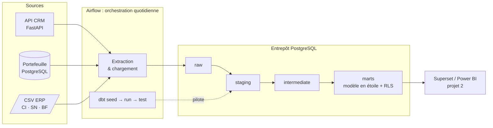
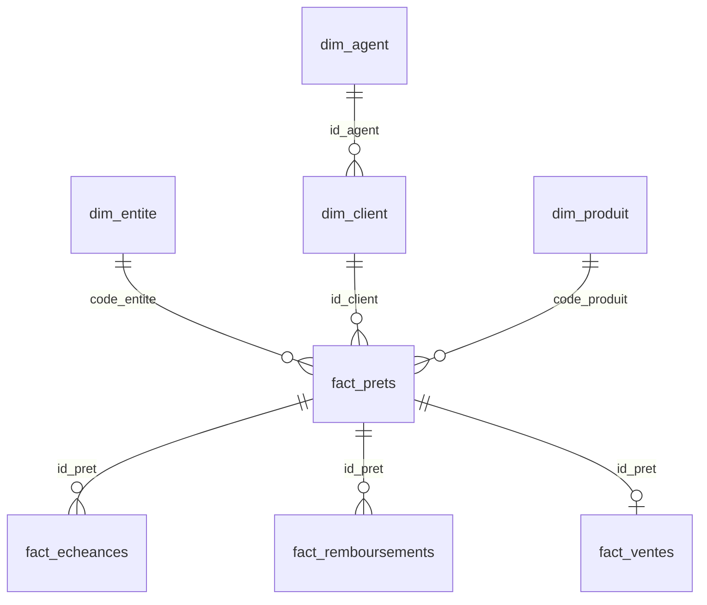
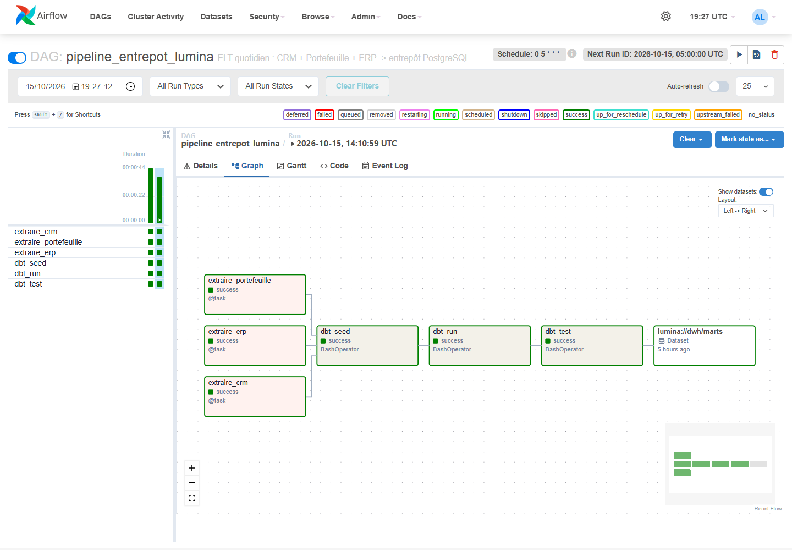
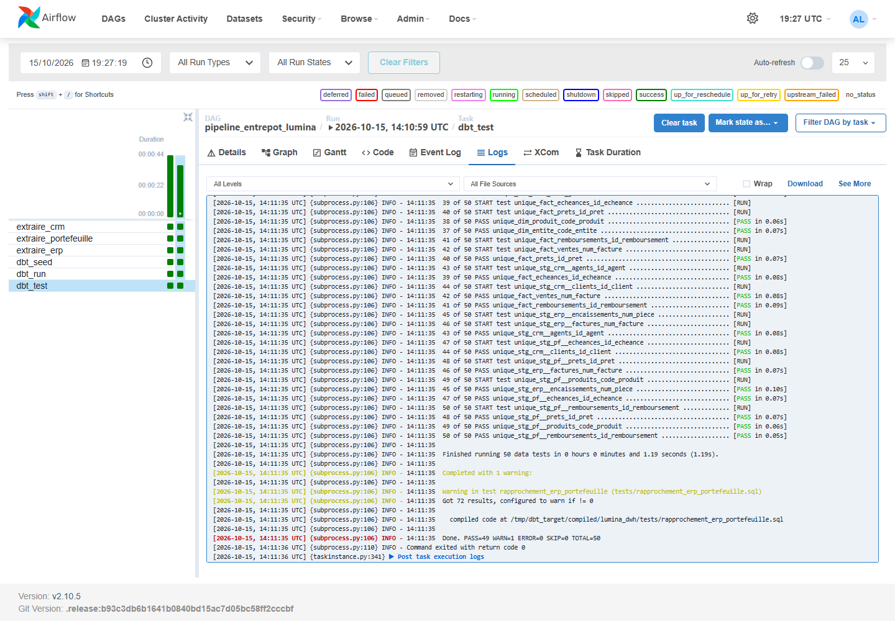
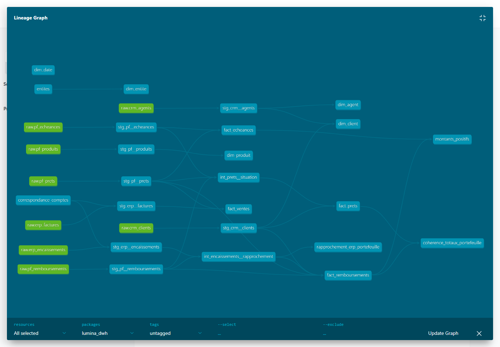

> 🔗 **Lumina Data Platform** : [1. Entrepôt](https://github.com/Isac9/lumina-data-platform-entrepot) · [2. Pilotage Superset](https://github.com/Isac9/lumina-data-platform-pilotage) · [3. Aide à la décision et gouvernance](https://github.com/Isac9/lumina-data-platform-aide-decision)

# Entrepôt de données multi-entités : Lumina Énergie

> Projet portfolio de Data Engineering : pipelines **ELT** (Airflow + dbt) qui alimentent un entrepôt **PostgreSQL** à partir de 3 sources (ERP, CRM, gestion de portefeuille de crédit), pour un groupe présent dans 3 pays.
> *Lumina Énergie est une entreprise fictive. Toutes les données sont générées.*

## Le contexte

Lumina Énergie vend des kits solaires, des foyers améliorés et des pompes agricoles **à crédit** (paiement mensuel par mobile money) en **Côte d'Ivoire, au Sénégal et au Burkina Faso**. Chaque filiale a :

- le même **CRM** (clients et agents), exposé par une API REST paginée ;
- le même **logiciel de gestion de portefeuille** (prêts, échéanciers, remboursements), une base PostgreSQL ;
- son propre export **ERP**, en fichiers CSV dont le **format** (séparateur, dates, montants) et le **plan de comptes** diffèrent d'un pays à l'autre.

Objectif : réunir ces données dans un entrepôt unique, fiable, traçable et sécurisé, qui servira de socle au reporting par entité et à la consolidation Groupe.

## Architecture



| Couche | Contenu | Matérialisation |
|---|---|---|
| `raw` | Copie fidèle des sources, plus la date de chargement | tables (`pf_remboursements` partitionnée par mois) |
| `staging` | Typage, nettoyage, harmonisation des formats ERP par pays | vues |
| `intermediate` | Situation des prêts, rapprochement ERP ↔ portefeuille | vues |
| `referentiel` | Entités, correspondance plan de comptes local → Groupe | seeds dbt |
| `marts` | Modèle en étoile : `dim_*`, `fact_*` | tables indexées, avec Row-Level Security |

## Ce que le projet démontre

- **ELT idempotent** : rechargement complet des tables brutes, que l'on peut relancer sans créer de doublons.
- **Harmonisation multi-entités** : 3 formats CSV différents et 3 plans de comptes ramenés au plan Groupe.
- **Administration PostgreSQL** : partitionnement mensuel, index, rôles, **Row-Level Security** par pays, sauvegardes `pg_dump` quotidiennes avec rétention de 7 jours.
- **Qualité des données** : 50 tests dbt (unicité, intégrité référentielle, valeurs autorisées) et des contrôles métier : rapprochement ERP ↔ portefeuille, cohérence des totaux, montants positifs.
- **Traçabilité** : `_charge_le` et `_fichier_source` sur chaque ligne brute, et un lignage complet dans dbt docs.

## Récupérer le code

Les projets 2 et 3 s'appuient sur les précédents : clone-les **côte à côte**, avec **exactement** ces noms de dossiers.

```bash
git clone https://github.com/Isac9/lumina-data-platform-entrepot.git projet1-entrepot-donnees
git clone https://github.com/Isac9/lumina-data-platform-pilotage.git projet2-tableaux-de-bord
git clone https://github.com/Isac9/lumina-data-platform-aide-decision.git projet3-aide-decision
```

## Démarrage rapide

```bash
docker compose up -d --build
```

| Service | Adresse | Identifiants |
|---|---|---|
| Airflow | http://localhost:8080 | admin / admin |
| API CRM | http://localhost:8000/docs | (aucun) |
| pgAdmin | http://localhost:5050 | mot de passe des bases : `lumina` / `portefeuille` |
| Entrepôt PostgreSQL | localhost:5434 | lumina / lumina |

## Modèle de données (marts)



## Documents

- [Architecture et choix techniques](docs/architecture.md)
- [Feuille de route](docs/feuille_de_route.md)

## Captures d'écran

**Le pipeline quotidien dans Airflow** : 3 extractions en parallèle, puis dbt (seed, run, test), et le signal « marts prêts » qui déclenche le reporting.



**Les contrôles qualité dbt** : 50 contrôles, dont un avertissement voulu (72 écarts ERP ↔ portefeuille détectés).



**Le lignage des données** (catalogue dbt) : des sources brutes jusqu'au modèle en étoile.


